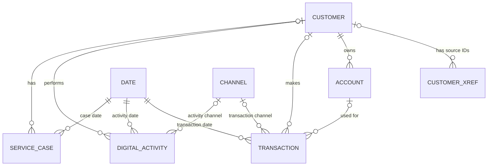

# Customer 360 Warehouse Data Model

## 1. Conceptual Data Model

### 1.1 Main Entities

| Entity | Description |
|---|---|
| Customer | Stores integrated customer information from the source systems. |
| Customer Cross-Reference | Links customer IDs from S1, S2 and S3 to the warehouse customer. |
| Account | Stores bank account details and links accounts to customers. |
| Date | Stores dates used for reporting. |
| Channel | Stores the channels used for transactions and digital activities. |
| Transaction | Stores settled transactions, including amounts and customer references. |
| Digital Activity | Stores customer activities, such as logins and balance checks. |
| Service Case | Stores customer service cases, including their status and severity. |

### 1.2 Main Relationships

| Relationship | Description |
|---|---|
| Customer → Customer Cross-Reference | One customer can have multiple source customer IDs. |
| Customer → Account | One customer can have multiple bank accounts. |
| Customer → Transaction | One customer can have multiple transactions. |
| Customer → Digital Activity | One customer can have multiple digital activities. |
| Customer → Service Case | One customer can have multiple service cases. |
| Account → Transaction | One account can have multiple transactions. |
| Date → Transaction / Digital Activity / Service Case | Each record is linked to a reporting date. |
| Channel → Transaction / Digital Activity | Each transaction or activity is linked to a channel. |

### 1.3 Conceptual Diagram

## 2. Logical Data Model

### 2.1 Warehouse Tables

| Table | Primary Key | Main Purpose |
|---|---|---|
| dim_customer | customer_key | Stores integrated customer identities. |
| customer_xref | xref_key | Links source customer IDs to warehouse customers. |
| dim_account | account_key | Stores banking accounts and their customer references. |
| dim_date | date_key | Stores dates for reporting. |
| dim_channel | channel_key | Stores transaction and activity channels. |
| fact_transaction | transaction_key | Stores transaction records and amounts. |
| fact_activity | activity_key | Stores digital activity records. |
| fact_service_case | case_key | Stores customer service cases. |
| etl_run_log | run_id | Stores ETL execution and record counts. |
| rejected_record | reject_key | Stores rejected source records and reasons. |

### 2.2 Keys and NULL Rules

| Table | Foreign Key | Nullable | References |
|---|---|---|---|
| customer_xref | customer_key | Yes | dim_customer |
| dim_account | customer_key | No | dim_customer |
| fact_transaction | customer_key | Yes | dim_customer |
| fact_transaction | account_key | Yes | dim_account |
| fact_transaction | date_key | No | dim_date |
| fact_transaction | channel_key | No | dim_channel |
| fact_activity | customer_key | Yes | dim_customer |
| fact_activity | date_key | No | dim_date |
| fact_activity | channel_key | No | dim_channel |
| fact_service_case | customer_key | Yes | dim_customer |
| fact_service_case | date_key | No | dim_date |

### 2.3 Column Definitions

### customer_xref
| Column | Data type | Nullable |
|---|---|---|
| xref_key | integer | NO |
| source_system | char(2) | NO |
| source_customer_id | varchar(24) | NO |
| customer_key | integer | YES |
| match_rule | varchar(20) | NO |
| match_status | varchar(10) | NO |

### dim_account
| Column | Data type | Nullable |
|---|---|---|
| account_key | integer | NO |
| account_id | varchar(20) | NO |
| customer_key | integer | NO |
| account_type | varchar(20) | NO |
| opened_date | date | NO |
| status | varchar(12) | NO |
| source_system | char(2) | NO |

### dim_channel
| Column | Data type | Nullable |
|---|---|---|
| channel_key | integer | NO |
| channel_code | varchar(12) | NO |
| channel_name | varchar(40) | NO |

### dim_customer
| Column | Data type | Nullable |
|---|---|---|
| customer_key | integer | NO |
| full_name | varchar(120) | NO |
| date_of_birth | date | YES |
| email | varchar(120) | YES |
| state | char(3) | YES |
| first_seen_at | timestamp without time zone | NO |
| match_quality | varchar(20) | NO |

### dim_date
| Column | Data type | Nullable |
|---|---|---|
| date_key | integer | NO |
| full_date | date | NO |
| day_of_week | varchar(12) | NO |
| month_no | integer | NO |
| quarter_no | integer | NO |
| year_no | integer | NO |

### etl_run_log
| Column | Data type | Nullable |
|---|---|---|
| run_id | integer | NO |
| run_at | timestamp without time zone | NO |
| step | varchar(40) | NO |
| source_count | integer | YES |
| loaded_count | integer | YES |
| rejected_count | integer | YES |

### fact_activity
| Column | Data type | Nullable |
|---|---|---|
| activity_key | integer | NO |
| activity_id | varchar(24) | NO |
| customer_key | integer | YES |
| date_key | integer | NO |
| channel_key | integer | NO |
| activity_type | varchar(24) | NO |
| activity_count | integer | NO |

### fact_service_case
| Column | Data type | Nullable |
|---|---|---|
| case_key | integer | NO |
| case_id | varchar(24) | NO |
| customer_key | integer | YES |
| date_key | integer | NO |
| case_type | varchar(24) | NO |
| status | varchar(12) | NO |
| severity | varchar(10) | NO |
| case_count | integer | NO |

### fact_transaction
| Column | Data type | Nullable |
|---|---|---|
| transaction_key | integer | NO |
| transaction_id | varchar(24) | NO |
| customer_key | integer | YES |
| account_key | integer | YES |
| date_key | integer | NO |
| channel_key | integer | NO |
| amount_aud | numeric | NO |
| transaction_count | integer | NO |
| status | varchar(10) | NO |

### rejected_record
| Column | Data type | Nullable |
|---|---|---|
| reject_key | integer | NO |
| source_system | char(2) | NO |
| source_table | varchar(40) | NO |
| source_key | varchar(40) | NO |
| reason | varchar(80) | NO |
| rejected_at | timestamp without time zone | NO |

## 3. Fact Table Grain

| Fact Table | Grain |
|---|---|
| fact_transaction | One row represents one accepted transaction. |
| fact_activity | One row represents one recorded digital activity. |
| fact_service_case | One row represents one recorded customer service case. |

## 4. Design Decisions

| Design Decision | Explanation |
|---|---|
| Integrated customer dimension | Customer information is combined into one warehouse dimension to support Customer 360 reporting. |
| Customer cross-reference | Source customer IDs from S1, S2 and S3 are linked to the integrated customer record. |
| Surrogate keys | The warehouse uses its own keys to connect dimensions and fact tables. |
| Identity matching | Customer identities are matched using defined rules instead of relying on names alone. |
| Ambiguous customers | If a customer cannot be matched confidently, the customer_key remains NULL. |
| Separate fact tables | Transactions, digital activities and service cases are stored separately because they represent different events. |
| Date dimension | A shared date dimension supports consistent reporting across the fact tables. |
| Channel dimension | A shared channel dimension supports transaction and digital activity reporting. |
| Data quality | Rejected records and ETL run details are stored to support checking and troubleshooting. |
