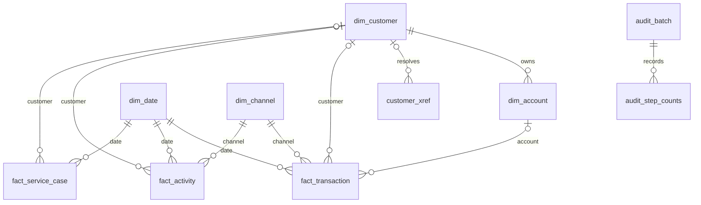

# Delivery warehouse model

This is a technical schema reference, not assessed report prose. The executable schema
is workspace/delivery/pipeline/20_warehouse.sql. COLUMN_DICTIONARY.csv is exported from the
verified database. See CONTRACT.md for transformations and null/rejection policies.

| Table | Grain | Key and lineage |
|---|---|---|
| dim_customer | One core customer | customer_key PK, core_customer_id UNIQUE |
| dim_account | One account with one PRIMARY owner | account_key PK, account_id UNIQUE, customer_key FK |
| dim_date | One calendar date across source event range | date_key PK, full_date UNIQUE |
| dim_channel | One source channel value | channel_key PK, channel_code UNIQUE |
| customer_xref | One customer ID in one source | xref_key PK, source_system + source_customer_id UNIQUE; nullable customer_key FK |
| fact_transaction | One accepted business transaction after deduplication | transaction_key PK; transaction_id UNIQUE; source_transaction_ref UNIQUE; dimension FKs |
| fact_activity | One accepted digital event | activity_key PK; activity_id UNIQUE; customer/date/channel FKs |
| fact_service_case | One accepted service case | case_key PK; case_id UNIQUE; customer/date FKs; no channel |
| rejected_record | One rejected source event | reject_key PK; source system/table/key, reason, amount if applicable, batch_id |
| etl_run_log | One fact load summary in current rebuild | run_id PK; batch_id and disposition counts |
| audit.batch | One persisted build attempt | batch_id PK; RUNNING/PASS/FAIL and timestamps |
| audit.step_counts | One fact-step summary per build | batch_id FK to audit.batch; preserved across rebuilds |

The reused DDL permits nullable customer/account keys on some facts; the delivery ETL
and acceptance checks enforce resolved keys for all loaded events. NULL remains valid
in customer_xref for ambiguous/unmatched profiles. This distinction between schema
permissiveness and load policy must be understood when changing the pipeline.
