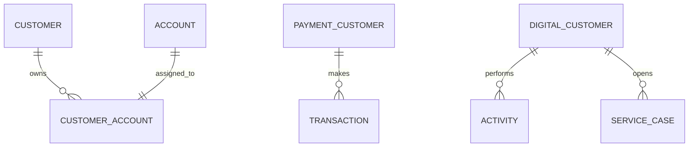
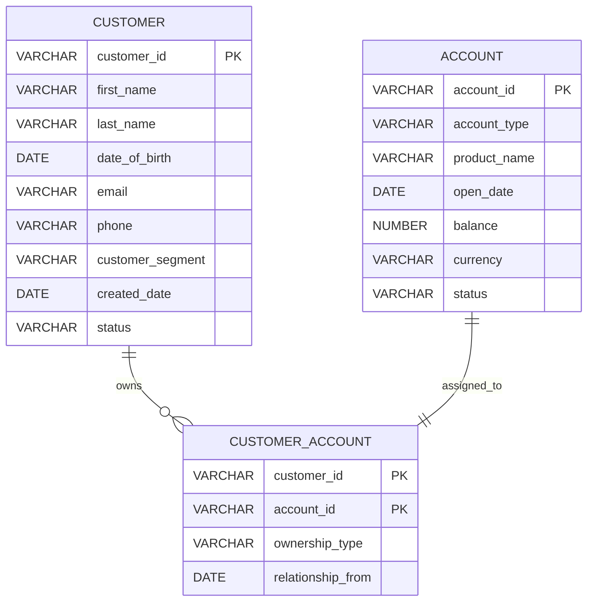
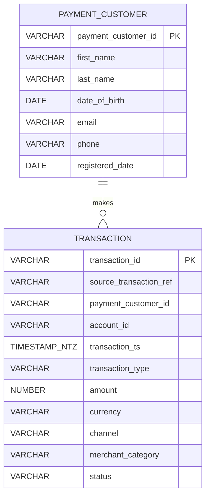
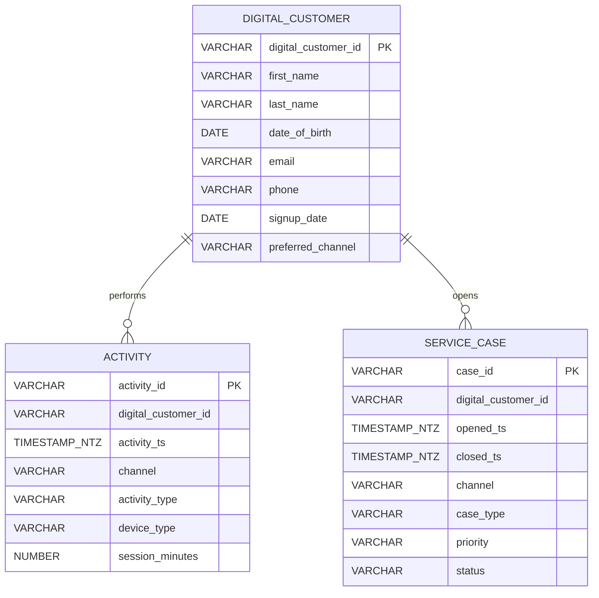

# Source system ER diagram

The three diagrams below are **independent source systems**. There is no foreign key between databases. A person can be `C0001` in Core Banking, `P1001` in Payments, and `D1001` in Digital Service at the same time. Those ids are different keys. The warehouse team links them later with `customer_xref`, using `expected_results.csv` as the test fixture.

`CUSTOMER_ACCOUNT.customer_id` and `CUSTOMER_ACCOUNT.account_id` are logical references inside Core Banking. They are not enforced foreign keys. Payments `account_id` uses the same `A#####` format so it can be integrated later. It is not a foreign key, and `A99999` is an intentional missing account.

## Core Banking — `CBA_CORE_BANKING.CORE`

One account has one `PRIMARY` owner in this prototype. A customer may own more than one account.

## Payments — `CBA_PAYMENTS.PAYMENT_SRC`

`source_transaction_ref` is not unique. `T000100` and `T002001` share `BREF-000100`.

## Digital and Service — `CBA_DIGITAL_SERVICE.DIGITAL_SRC`

`ACT000050` and `SC00020` point at `D0000`, which is not a digital customer. Those rows are rejected-record fixtures, not a modelled relationship.
